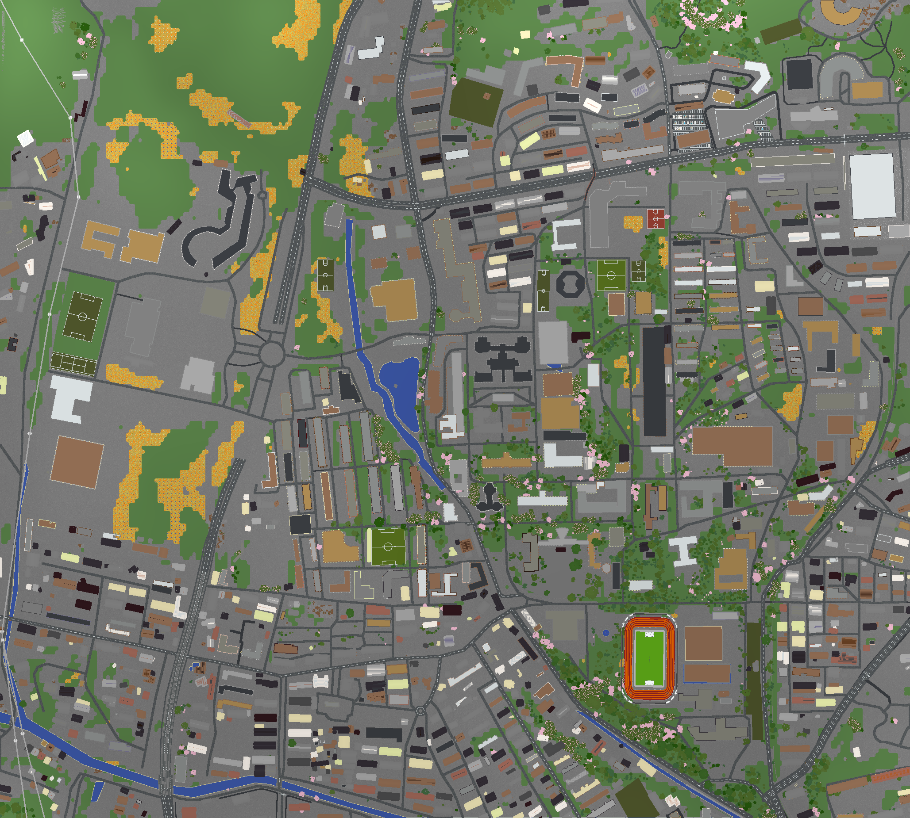

# DUT in Minecraft — 大连理工大学凌水校区

> 用 [Arnis](https://github.com/louis-e/arnis) 把整个大连理工大学凌水校区搬进 Minecraft，真实地形、真实建筑、1:1 比例。

<p align="center">
  
</p>

<p align="center">
  
</p>

## 世界概览

| 项目 | 内容 |
|---|---|
| 覆盖范围 | 大连理工大学凌水校区全域 + 周边约 50 m（东西约 2.1 km × 南北约 1.9 km） |
| 生成工具 | [Arnis](https://github.com/louis-e/arnis) v3.2.0（`geo-terrain` 模式） |
| 游戏版本 | **Minecraft Java 1.21.4+**（世界 DataVersion = 4189） |
| 世界比例 | 1:1（每米一方块） |
| 建筑数量 | 686 栋（OSM + Overture Maps 建筑足印） |
| 体育场 | 独立 3D 模型还原，约 116,253 个方块 |
| 地形 | Mapterhorn GLO-30 真实高程，校园高差约 114 m |
| 植被 | Meta/WRI 全球树冠高度图，树冠覆盖约 6.3%（平均高 5.1 m，最高 22 m） |
| 标识 | 24 个公交站牌、限速牌、禁止驶入牌等 |
| 出生点 | 校园中心教学区附近（MC 坐标 1530, -38, 1146），物品栏附带全图锁定地图 |

## 下载与安装

**⬇️ 世界文件请到 [Releases](../../releases) 页面下载 zip 压缩包**（约 30 MB）。

1. 解压得到文件夹「大连理工大学凌水校区」（内含 `level.dat`、`region/`、`icon.png` 等）；
2. 复制到你的 saves 目录：
   - Windows：`%appdata%\.minecraft\saves`
   - macOS：`~/Library/Application Support/minecraft/saves`
   - Linux：`~/.minecraft/saves`
3. 启动 **Minecraft Java 1.21.4 或更高版本**（更低版本无法打开该世界），进入单人游戏即可。

> 进入世界后建议双击空格起飞俯瞰校园；出生点自带一张全图锁定地图。常用指令：`/tp @s 1530 -38 1146`（回出生点）、`/gamemode spectator`（旁观模式）。

完整使用说明见 [docs/使用说明.txt](docs/使用说明.txt)。

## 目录结构

```
DUT-in-Minecraft/
├── scripts/                    # 生成与加工全流程脚本
│   ├── run_arnis.sh            # Arnis 主生成命令（bbox / 模式 / 比例等参数）
│   ├── launch_arnis_daemon.py  # 双 fork 守护方式后台运行 Arnis（绕过沙箱进程清理）
│   ├── polish_world.py         # 世界重命名 + LevelName 修改 + 自定义图标
│   ├── make_preview_map.py     # OSM 瓦片拼接绘制范围预览图（边界 / 标注 / 比例尺）
│   ├── scan_world.py           # 遍历 region 文件统计各 Y 层非空区块，验证高度分布
│   ├── inspect_chunk.py        # 解压解剖单个 Anvil 区块，校验 NBT 方块数据
│   └── package_deliverable.py  # region 完整性校验 + 组装交付目录 + 打 zip
├── data/
│   ├── campus_polygon.json     # OSM Way 443031231 校区多边形（Nominatim/OSM API 获取）
│   └── dut_pois.json           # 校区主要地点 POI（四门 / 体育场 / 中心广场等）
├── docs/
│   ├── 使用说明.txt             # 世界使用说明（含常见问题）
│   ├── Arnis命令参数.txt        # 本世界生成配置 + Arnis 参数自定义指南
│   └── arnis-generation.log    # 本次生成的完整运行日志
└── previews/                   # 预览图
```

> ⚠️ 脚本中的绝对路径（`/home/z/my-project/...`）来自本次构建环境，复现时请按自己的目录修改。

## 如何自己生成一个校园

1. **安装 Arnis**：到 [Arnis Releases](https://github.com/louis-e/arnis/releases) 下载对应平台的程序（Windows 选 `arnis-windows.exe`，Linux 选 tar.gz 或 AppImage，macOS 选 universal 包）。

2. **确定范围**：打开 [OpenStreetMap](https://www.openstreetmap.org) 找到目标区域，记录bbox（最小纬度，最小经度，最大纬度，最大经度）。本项目的取值是校区多边形外扩约 50 m，确保边界道路与校门完整生成：

   ```
   38.87318, 121.50831, 38.88981, 121.53206
   ```

3. **执行生成**（即 [scripts/run_arnis.sh](scripts/run_arnis.sh) 的核心命令）：

   ```bash
   arnis --bbox "38.87318,121.50831,38.88981,121.53206" \
         --output-dir ~/.minecraft/saves \
         --mode geo-terrain \
         --scale 1 \
         --spawn-lat 38.8795 \
         --spawn-lng 121.5260 \
         --map-preview \
         --gamemode creative \
         --world-time 6000
   ```

4. **后续加工**（可选）：参照 `polish_world.py` 重命名世界、`make_preview_map.py` 制作范围预览图、`package_deliverable.py` 校验打包。

更多参数（`--interior`、`--scale 2`、`--bedrock`、`--signage` 等）见 [docs/Arnis命令参数.txt](docs/Arnis命令参数.txt)。本次生成的实际运行日志见 [docs/arnis-generation.log](docs/arnis-generation.log)。

## 踩坑记录

- **`--downloader curl` 会全军覆没**：Arnis 的 curl 模式对含逗号/花括号的 Overpass URL 未做编码，curl 8 直接报 `URL rejected`（exit 3）。用默认的 requests 模式即可。
- **沙箱环境跑不了长任务**：容器沙箱会在命令结束后清理后台进程，`nohup` / `setsid` 均无效；采用双 fork 孤儿进程守护（见 `launch_arnis_daemon.py`）后成功运行约 2.5 分钟完成生成。
- **nbtlib 修改 LevelName 的类型坑**：直接赋 Python 字符串会存成错误类型，必须用 `nbtlib.String("...")` 包装后再写入。
- **Anvil 区块压缩码**：1 = GZip，2 = Zlib，3 = 未压缩；用 Python 解析 region 文件时别只解压一种。

## 数据来源与许可

| 数据 | 来源 | 许可 |
|---|---|---|
| 路网 / 建筑 / 水系 / POI | © [OpenStreetMap](https://www.openstreetmap.org/copyright) 贡献者 | ODbL |
| 建筑足印补充 | © [Overture Maps Foundation](https://overturemaps.org) | ODbL |
| 高程地形 | Mapterhorn（GLO-30 DEM） | 公开数据 |
| 树冠高度 | Meta / WRI Global Canopy Height | 公开数据 |
| 生成工具 | [Arnis](https://github.com/louis-e/arnis) v3.2.0 | GPL-3.0 |

本仓库中的脚本以 [MIT License](LICENSE) 发布；生成的世界文件为上述开放地理数据的衍生作品，请遵循相应许可（ODbL 要求署名与同许可共享）。

## 致谢

感谢所有 OpenStreetMap、Overture Maps 贡献者，以及 Arnis 的开发者 [@louis-e](https://github.com/louis-e)。

---

<p align="center">大工等你来盖楼 ⛏️ · 连理园里见 🎓</p>
